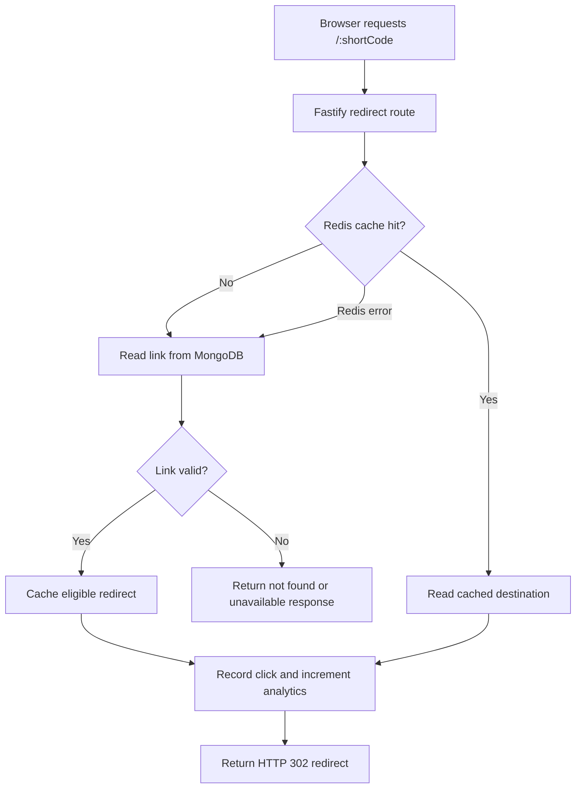

# Shortify Architecture

Shortify is a full-stack URL shortener and click analytics application built as a modular monolith. The React frontend communicates with a Fastify API. MongoDB is the source of truth for users, links, and click records. Redis provides redirect caching and atomic rate limiting.

The API owns business rules, authentication, link management, redirects, and analytics. The frontend is responsible for the user interface and does not access MongoDB or Redis directly.

## 1. Technology Stack

| Layer | Technology | Responsibility |
|---|---|---|
| Frontend | React, TypeScript, Vite | Dashboard and link management |
| API | Node.js, TypeScript, Fastify | HTTP endpoints and business logic |
| Validation | Zod | Request validation |
| Database | MongoDB, Mongoose | Users, links, and click analytics |
| Cache | Redis, ioredis | Redirect cache and rate limiting |
| Authentication | JWT, Argon2id | Authentication and password hashing |
| Logging | Pino | Structured application logs |
| Testing | Jest, Testcontainers, Vitest | API integration and frontend tests |
| Infrastructure | Docker Compose, Nginx | Local services and frontend serving |

## 2. Application Structure

```text
Browser
  |
  v
React + Vite
  |
  | HTTP / JSON
  v
Fastify API
  |
  +--------------------+
  |                    |
  v                    v
MongoDB               Redis
  |                    |
  |                    +-- Redirect cache
  |                    +-- Rate limiting
  |
  +-- Users
  +-- Links
  +-- Click records
```

The application follows a modular monolith architecture.

- Routes define HTTP endpoints and connect middleware to controllers.
- Controllers handle HTTP request and response concerns.
- Services contain business rules and application logic.
- MongoDB stores durable application data.
- Redis handles caching and rate limiting.

There is no separate microservice layer, message queue, or second database.

## 3. Data Ownership

### MongoDB — Source of Truth

MongoDB stores the durable application data.

| Collection | Responsibility |
|---|---|
| Users | User accounts and authentication information |
| Links | Original URLs, short codes, ownership, expiry, and status |
| Clicks | Redirect click events and analytics data |

Important database constraints and indexes include:

- Unique email index for user accounts.
- Unique short-code index for links.
- Owner-related indexes for user link queries.
- Click-related indexes for analytics date-range queries.

MongoDB remains authoritative even when Redis contains cached redirect data.

### Redis — Cache and Rate Limiting

Redis is used for:

| Feature | Purpose |
|---|---|
| Redirect cache | Avoid repeated MongoDB reads for popular short links |
| Fixed-window rate limiting | Enforce request limits atomically |
| Lua scripts | Perform rate-limit increment and expiry operations atomically |

Redis is not the permanent storage layer. Losing cached data does not delete users or links.

## 4. Short URL Generation

Shortify generates seven-character Base62 short codes.

The Base62 character set contains:

- Lowercase letters
- Uppercase letters
- Digits

The generation flow is:

1. Generate a candidate short code.
2. Check persistence through the MongoDB unique index.
3. Attempt to insert the link.
4. If a duplicate-key error occurs, generate another candidate and retry a limited number of times.
5. Return the created link when the insert succeeds.

The unique MongoDB index is the final protection against duplicate short codes.

Custom aliases are also supported. If an alias is already taken, the API returns a conflict response (`409`).

## 5. Redirect Request Flow

Redirects are designed to use Redis when possible and fall back to MongoDB when necessary.



The redirect behavior is:

1. Look up the short code in Redis.
2. If the cache contains a valid destination, use it.
3. On a cache miss, read the link from MongoDB.
4. If Redis is unavailable, fall back to MongoDB.
5. Validate that the link exists, is enabled, and has not expired.
6. Record the click and increment the link's click counter.
7. Return an HTTP `302` redirect.

Missing, disabled, and expired links are not cached.

A cached redirect can continue working while MongoDB is unavailable, until its cache entry expires. An uncached redirect requires MongoDB.

## 6. Redis Cache Strategy

Shortify uses a cache-aside strategy.

```text
Request
   |
   v
Redis lookup
   |
   +-- Cache hit --> Use cached destination
   |
   +-- Cache miss --> Read MongoDB
                          |
                          v
                     Cache result
                          |
                          v
                     Return result
```

Key design decisions:

- MongoDB remains authoritative.
- Redis cache entries have a configured TTL.
- Invalid or unavailable links are not cached.
- Redis failures during redirect lookup fall back to MongoDB.
- Link updates and deletions invalidate the relevant cache entry.

Cache invalidation and MongoDB writes are not one atomic transaction. This is an acknowledged consistency limitation.

## 7. Rate Limiting

Shortify uses a shared Redis fixed-window rate limiter.

Rate limits are applied to sensitive operations, including:

- User registration
- User login
- Link creation

The rate limiter uses a Lua script to increment a counter and apply its expiry atomically.

When a request exceeds its configured limit:

- The API returns HTTP `429`.
- A `Retry-After` header communicates when the client can retry.

When Redis is unavailable, rate-limited write operations return HTTP `503` and do not continue.

A fixed-window limiter can allow bursts around window boundaries. This is a known trade-off of the current implementation.

## 8. Authentication and Authorization

Authentication uses JWT-based access tokens.

Password handling uses Argon2id hashing.

The API enforces ownership checks so users can only manage their own links.

Important security controls include:

- Password hashing with Argon2id.
- JWT authentication.
- Owner-scoped link operations.
- HTTP and HTTPS URL validation.
- Helmet security headers.
- Configured CORS origin.
- JSON request body size limit.
- Sensitive-value redaction in structured logs.

The current implementation stores bearer tokens in browser local storage. Refresh-token rotation and token revocation are not implemented.

## 9. Click Analytics

Successful redirects generate click records.

The analytics flow:

1. Resolve the short code.
2. Validate that the link is active.
3. Insert a click record.
4. Increment the link's `totalClicks` counter.
5. Return the redirect response.

The click insertion and counter increment are separate database operations, not one transaction.

Analytics are best effort: an analytics failure does not prevent an otherwise valid redirect.

The application also provides dashboard statistics and link-level analytics endpoints.

## 10. API Responsibilities

| Endpoint | Responsibility |
|---|---|
| `POST /api/auth/register` | Register a user |
| `POST /api/auth/login` | Authenticate a user |
| `GET /api/auth/me` | Get the authenticated user |
| `POST /api/links` | Create a short link |
| `GET /api/links` | List the user's links |
| `GET /api/links/:id` | Get link details |
| `PATCH /api/links/:id` | Update a link |
| `DELETE /api/links/:id` | Delete a link |
| `GET /api/links/:id/analytics` | Get link analytics |
| `GET /api/dashboard/stats` | Get dashboard statistics |
| `GET /:shortCode` | Redirect to the original URL |
| `GET /api/health/live` | Liveness check |
| `GET /api/health/ready` | Readiness check |

## 11. Failure Handling

| Failure | Expected behavior |
|---|---|
| Redis unavailable during redirect | Fall back to MongoDB |
| Redis unavailable during registration or login | Return `503` |
| Redis unavailable during link creation | Return `503` |
| Redis unavailable during link update or deletion | Return `503`; leave the operation unchanged |
| MongoDB unavailable | Readiness fails; database-dependent operations fail |
| MongoDB unavailable but redirect is cached | Cached redirect may work until TTL expires |
| Analytics write fails | Redirect continues; analytics may be incomplete |

The Redis client currently does not reconnect after its connection ends. Restarting the API after Redis becomes available is required in that situation.

## 12. Local Development and Docker

Requirements:

- Node.js 22
- npm
- Docker and Docker Compose

Local setup:

```bash
cp .env.example .env
npm ci
npm run dev
npm run dev:web
```

Default local development endpoints:

| Service | URL |
|---|---|
| API | `http://localhost:8080` |
| Web application | `http://localhost:3000` |
| MongoDB | `localhost:27017` |
| Redis | `localhost:6379` |

Docker Compose runs the API, web application, MongoDB, and Redis. Nginx serves the frontend and provides SPA fallback routing.

## 13. Testing Strategy

The project uses different testing tools for different layers.

| Tool | Purpose |
|---|---|
| Jest | Backend tests |
| Testcontainers | Integration tests with real MongoDB and Redis containers |
| Vitest | Frontend tests |

Useful validation commands:

```bash
npm run typecheck
npm test
npm run build
```

Testcontainers requires Docker to be available.

## 14. Known Limitations and Trade-offs

The current implementation intentionally keeps the architecture simple.

Known limitations include:

- Bearer tokens are stored in local storage.
- Refresh-token rotation and token revocation are not implemented.
- Rate limiting uses fixed windows and can allow boundary bursts.
- `trustProxy` is disabled, so forwarded client IP headers are not trusted.
- Redis does not automatically reconnect after its connection ends.
- MongoDB writes and Redis cache invalidation are not transactional.
- Click insertion and click-counter updates are not transactional.
- Analytics are best effort.
- Missing short codes are not cached.
- There is no redirect cache stampede lock.
- Link search uses regular expressions.
- GeoIP country analytics are not implemented.
- Custom domains are not implemented.

These are current implementation boundaries, not claims of production-grade guarantees.

## 15. Design Principles

The main architectural decisions are:

1. **MongoDB is authoritative:** durable application state belongs in the database.
2. **Redis is an optimization:** caching improves redirect performance without replacing persistent storage.
3. **Atomic rate limiting:** Lua scripts prevent concurrent requests from incorrectly updating rate-limit counters.
4. **Unique database constraints:** short-code uniqueness is enforced by MongoDB, not only application checks.
5. **Modular monolith:** business logic stays organized without unnecessary service distribution.
6. **Explicit failure behavior:** Redis and MongoDB failures have defined API behavior.
7. **Testable boundaries:** backend integration tests use real service containers to validate important behavior.
