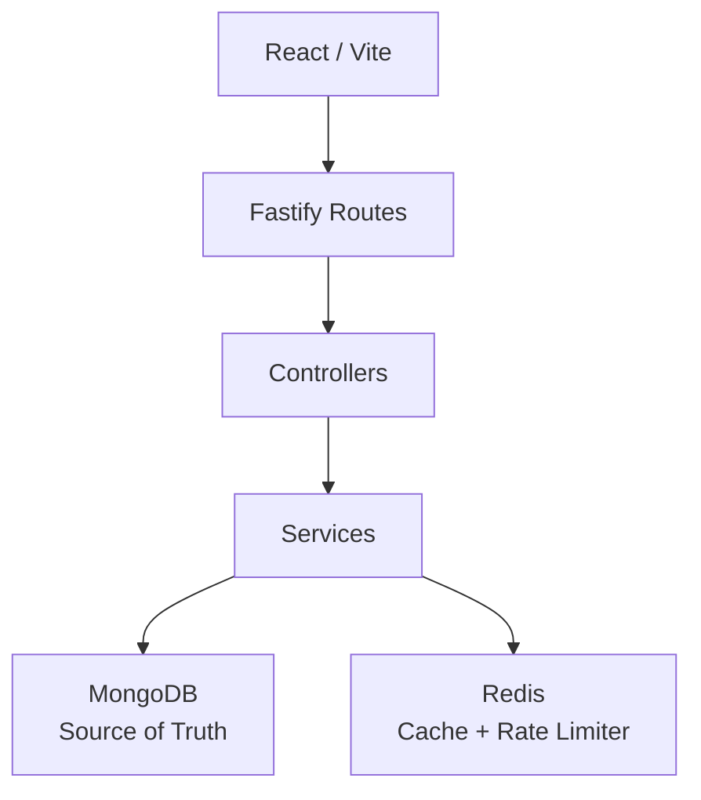

# Shortify

Shortify is a full-stack URL shortener and click analytics platform. It is a portfolio project for backend and system-design work: authentication, short-code uniqueness, Redis cache-aside, a shared rate limiter, and MongoDB aggregations. It is not a deployed production service.

## Overview

A signed-in user creates an `http` or `https` link and receives a short code. Opening `http://localhost:8080/<code>` asks the API for a redirect. The dashboard shows that user's links and click totals. The browser talks only to the API. MongoDB stores accounts, links, and clicks. Redis caches redirects and counts rate limits.

## Key features

- 7-character Base62 short codes, with custom aliases
- Expiration, enable, and disable
- JWT authentication and Argon2id password hashing
- Redis cache-aside redirects, with MongoDB as the source of truth
- A Redis fixed-window rate limit shared by API processes
- Click events, atomic `totalClicks`, and dashboard aggregations
- MongoDB indexes for email, short code, owner lists, and click ranges
- Unique short codes guarded by a MongoDB unique index and a short retry
- Docker Compose
- API integration tests against real MongoDB and Redis

## Architecture



The API is one modular monolith. Routes wire HTTP and authentication. Controllers read the request and set the status. Services own the rules and call MongoDB or the Redis helpers. There is no repository layer, queue, or second database.

A redirect reads Redis, falls back to MongoDB on a miss or a cache error, records the click, then returns 302.

## Tech stack

| Area | Choice |
| --- | --- |
| Backend | Node.js 22, TypeScript, Fastify, Zod, Pino, Argon2id, JWT |
| Frontend | React, TypeScript, Vite, React Router, TanStack Query |
| Database | MongoDB 7, Mongoose |
| Cache | Redis 7, ioredis |
| Testing | Jest and Testcontainers for the API, Vitest for the web app |
| DevOps | Docker Compose, GitHub Actions |

## Engineering highlights

**Short codes.** Generated codes are Base62. A custom alias uses the same `shortCode` field. The unique index is the concurrency guard. A duplicate generated code is retried a few times. A duplicate alias returns 409.

**Redirect cache.** A valid Redis hit redirects without reading MongoDB for the destination. A miss or a Redis error reads MongoDB and may fill the cache. Missing, disabled, and expired codes are not cached. MongoDB stays authoritative. A cache entry can still 302 after MongoDB stops, until its TTL.

**Rate limit.** Register, login, and link creation share a Redis counter. One Lua script increments the counter and sets its TTL. Over the limit is 429 with `Retry-After`. If Redis cannot decide, those writes return 503 and do not run. A fixed window can allow two bursts around the boundary.

**Analytics.** A successful redirect inserts a click event and then `$inc`s `totalClicks`. Those two writes are not one transaction. If either fails, the redirect is still 302. Disabled, missing, and expired codes do not record a click.

## Local setup

Requirements: Node.js 22, npm, and Docker if you run MongoDB, Redis, or the Compose stack.

```bash
cp .env.example .env
npm ci
npm run dev
```

In another terminal:

```bash
npm run dev:web
```

The API listens on `http://localhost:8080`. Vite listens on `http://localhost:3000`. `.env.example` contains local placeholders only. Change `JWT_SECRET` and `ANALYTICS_IP_SALT` before any shared deployment.

There is no lint script.

## Environment variables

| Variable | Purpose |
| --- | --- |
| `PORT` | API port. Default `8080` |
| `MONGODB_URI` | MongoDB connection string |
| `REDIS_URL` | Redis connection string |
| `JWT_SECRET` | HMAC secret for access tokens. Minimum 16 characters |
| `JWT_EXPIRES_IN` | Access token lifetime, such as `1d` |
| `PUBLIC_BASE_URL` | Origin used to build `shortUrl` |
| `CORS_ORIGIN` | One allowed browser origin |
| `REDIRECT_CACHE_TTL_SECONDS` | Maximum redirect cache TTL. Default `300` |
| `AUTH_REGISTER_RATE_LIMIT` / `AUTH_REGISTER_RATE_WINDOW_SECONDS` | Registration limit. Defaults `5` / `60` |
| `AUTH_LOGIN_RATE_LIMIT` / `AUTH_LOGIN_RATE_WINDOW_SECONDS` | Login limit. Defaults `10` / `60` |
| `LINK_CREATE_RATE_LIMIT` / `LINK_CREATE_RATE_WINDOW_SECONDS` | Link-creation limit. Defaults `10` / `60` |
| `ANALYTICS_IP_SALT` | Salt for hashing redirect client addresses. Minimum 16 characters |
| `VITE_API_BASE_URL` | API origin baked into the web build. `VITE_API_URL` is the fallback |

`VITE_*` values are public. Secrets stay on the API.

## Testing

```bash
npm run typecheck
npm test
npm run build
```

API tests start MongoDB and Redis with Testcontainers, so Docker must be available. CI on GitHub-hosted runners uses that same suite. Web tests use Vitest.

## Docker

```bash
docker compose up --build
```

| Service | Host URL |
| --- | --- |
| API | `http://localhost:8080` |
| Web | `http://localhost:3000` |
| MongoDB | `localhost:27017` |
| Redis | `localhost:6379` |

Inside Compose, the API uses the hostnames `mongo` and `redis`. nginx serves the Vite build and falls back to `index.html`, so a refresh of `/dashboard` or `/links/:id` stays in the SPA.

## API overview

| Method | Path | Auth |
| --- | --- | --- |
| `POST` | `/api/auth/register` | no |
| `POST` | `/api/auth/login` | no |
| `GET` | `/api/auth/me` | yes |
| `POST` | `/api/links` | yes |
| `GET` | `/api/links` | yes |
| `GET` | `/api/links/:id` | yes |
| `PATCH` | `/api/links/:id` | yes |
| `DELETE` | `/api/links/:id` | yes |
| `GET` | `/api/links/:id/analytics` | yes |
| `GET` | `/api/dashboard/stats` | yes |
| `GET` | `/:shortCode` | no |
| `GET` | `/api/health/live` | no |
| `GET` | `/api/health/ready` | no |

Request and status details are in [docs/api.md](docs/api.md).

## Failure behavior

Redis down and MongoDB up: a redirect still returns 302 from MongoDB. Register, login, and link creation return 503 and do not write. Update and delete return 503 and leave the document unchanged. Readiness stays 200 and reports `redis: down`.

MongoDB down: readiness is 503. A cached redirect can still return 302 until the cache TTL. An uncached redirect, and writes that need MongoDB, fail. Redis does not reconnect after its client connection ends. Restart the API after Redis returns.

The full matrix is in [docs/architecture.md](docs/architecture.md).

## Security

Passwords are Argon2id hashes. Link access is scoped to the owner. Destinations must be `http` or `https`. The API sets Helmet headers, allows one CORS origin, and limits JSON bodies to 32 KiB. Logs redact credentials. Click records store an IP hash, not the raw address. Details and limits are in [docs/security.md](docs/security.md).

## Known limitations

- The access token is a bearer token in `localStorage`. There is no refresh token or revocation list.
- The rate limiter is a fixed window and can allow two bursts at a boundary.
- `trustProxy` is off. `X-Forwarded-For` is not trusted.
- The Redis client does not reconnect after the connection ends.
- A MongoDB write and the Redis cache delete are not one transaction.
- The click insert and `totalClicks` increment are not one transaction. Analytics is best-effort.
- Missing codes are not cached, and simultaneous misses are not locked.
- Link search is a regular expression.
- There is no GeoIP lookup, so `country` stays null.
- There are no custom domains.

## Documentation

- [Architecture](docs/architecture.md)
- [Security](docs/security.md)
- [API](docs/api.md)
- [Changelog](CHANGELOG.md)

## License

[MIT](LICENSE)
