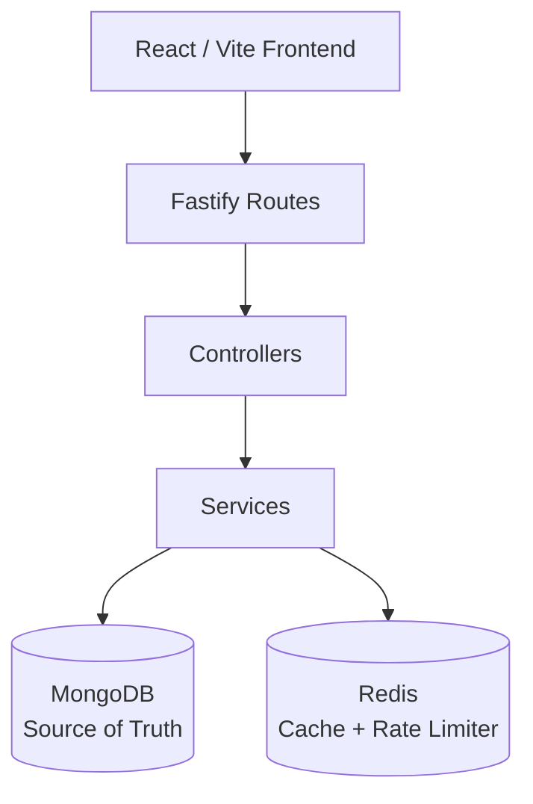

[](https://github.com/abhinav0988/shortify/actions/workflows/ci.yml)
# 🔗 Shortify – URL Shortener & Analytics Platform

**A full-stack URL shortener demonstrating backend engineering, API design, caching strategies, rate limiting, and analytics.**

Shortify is an independent portfolio project built using Node.js, TypeScript, Fastify, MongoDB, Redis, and React.

Users can create short URLs, manage their links, and monitor click analytics through a dashboard.

The project focuses on practical backend engineering concepts, including authentication, short-code uniqueness, Redis cache-aside, distributed rate limiting, and MongoDB aggregations.

> This is a portfolio project and is not deployed as a production service.

---

## 🚀 Key Features

- 7-character Base62 short-code generation.
- Custom URL aliases.
- URL expiration and enable/disable functionality.
- JWT authentication.
- Argon2id password hashing.
- Redis cache-aside redirect strategy.
- MongoDB as the source of truth.
- Shared Redis fixed-window rate limiting.
- Atomic rate limiting using Redis Lua scripts.
- Click event tracking and analytics.
- Atomic `totalClicks` updates.
- MongoDB aggregation pipelines.
- Unique short-code enforcement using MongoDB indexes.
- Docker Compose development environment.
- API integration testing using Jest and Testcontainers.
- Frontend testing using Vitest.
- CI workflows using GitHub Actions.

---

## 🛠️ Technology Stack

| Area | Technologies |
|---|---|
| Backend | Node.js 22, TypeScript, Fastify |
| Validation | Zod |
| Logging | Pino |
| Authentication | JWT, Argon2id |
| Frontend | React, TypeScript, Vite |
| Routing | React Router |
| Data Fetching | TanStack Query |
| Database | MongoDB 7, Mongoose |
| Caching | Redis 7, ioredis |
| Testing | Jest, Testcontainers, Vitest |
| Infrastructure | Docker, Docker Compose |
| CI/CD | GitHub Actions |

---

## 🏗️ System Architecture

Shortify follows a modular monolith architecture.

The frontend communicates with the backend API. The backend manages authentication, URL creation, redirects, caching, rate limiting, and analytics.



### Architecture Responsibilities

| Component | Responsibility |
|---|---|
| React / Vite | User interface and dashboard |
| Fastify | HTTP routing and request handling |
| Controllers | Request processing and HTTP responses |
| Services | Business logic and application rules |
| MongoDB | Accounts, links, and click records |
| Redis | Redirect caching and rate limiting |

The API uses a modular monolith architecture. Routes handle HTTP and authentication, controllers process requests, and services own the business rules.

There is no separate repository layer, message queue, or second database.

---

## 🧠 Engineering Highlights

### 1. Base62 Short-Code Generation

Shortify generates 7-character Base62 short codes.

The Base62 character set uses:

```text
0123456789ABCDEFGHIJKLMNOPQRSTUVWXYZabcdefghijklmnopqrstuvwxyz
```

Custom aliases use the same `shortCode` field.

MongoDB's unique index provides the concurrency safeguard.

When a generated code conflicts with an existing code, the application retries a limited number of times.

A duplicate custom alias returns HTTP 409 Conflict.

### 2. Redis Cache-Aside Strategy

Shortify uses Redis to cache frequently accessed redirect information.

**Redirect flow:**

```text
             User opens short URL
                      |
                      v
                Fastify API
                      |
                      v
                 Check Redis
                      |
             +--------+--------+
             |                 |
           Cache Hit        Cache Miss
             |                 |
             v                 v
        Get Destination    Query MongoDB
             |                 |
             |                 v
             |             Valid Link?
             |                 |
             |             +---+---+
             |             |       |
             |            Yes      No
             |             |       |
             |             v       v
             |          Cache    Return Error
             |          Result
             |             |
             +------+------+
                    |
                    v
               HTTP 302
```

**Implementation behavior:**

- A valid Redis cache hit redirects without querying MongoDB for the destination.
- A cache miss reads MongoDB.
- A Redis error falls back to MongoDB.
- Valid redirect information may be cached.
- Missing, disabled, and expired codes are not cached.
- MongoDB remains the authoritative data store.

A cached redirect can still return HTTP 302 after MongoDB becomes unavailable, until its cache TTL expires.

### 3. Distributed Rate Limiting with Redis Lua

Shortify implements a shared fixed-window rate limiter using Redis.

It protects:

- User registration.
- User login.
- Link creation.

An atomic Redis Lua script performs two operations:

1. Increments the request counter.
2. Sets the expiration time.

Both operations execute atomically on the Redis server.

**Behavior:**

- Requests within the configured limit are allowed.
- Requests exceeding the limit return HTTP 429.
- The response includes a `Retry-After` header.
- If Redis cannot determine the rate limit, the affected write requests return HTTP 503.

A fixed-window rate limiter can permit two bursts around a window boundary. This is a known limitation of the current implementation.

### 4. MongoDB Unique Index and Concurrent URL Creation

Shortify protects short-code uniqueness using a MongoDB unique index.

During concurrent URL creation:

- Multiple requests may attempt to generate the same code.
- MongoDB enforces uniqueness.
- Duplicate generated codes are retried a limited number of times.
- Duplicate custom aliases return HTTP 409.

This prevents duplicate short codes from being stored.

### 5. Click Analytics

Shortify records click events and maintains an atomic `totalClicks` counter.

The redirect workflow:

1. Validates the short code.
2. Resolves the destination.
3. Records a click event.
4. Increments `totalClicks`.
5. Returns HTTP 302.

The click event insert and `totalClicks` increment are separate database operations, not one transaction.

Analytics is best-effort: if either analytics operation fails, the redirect still returns HTTP 302.

Disabled, missing, and expired links do not record clicks.

### 6. MongoDB Aggregation

MongoDB aggregation pipelines support dashboard analytics.

The dashboard provides link information and click totals for the authenticated user.

MongoDB indexes support:

- Email lookup.
- Short-code lookup.
- Owner-based link queries.
- Click date-range queries.

---

## 🔐 Security

Shortify implements several application security controls.

| Security Area | Implementation |
|---|---|
| Password Storage | Argon2id |
| Authentication | JWT |
| Authorization | Owner-scoped link access |
| URL Validation | Only HTTP and HTTPS destinations |
| HTTP Security | Helmet headers |
| CORS | One allowed browser origin |
| Request Size | JSON body limit of 32 KiB |
| Rate Limiting | Redis-based fixed-window limiter |
| Logging | Credential redaction |
| Analytics Privacy | Hashed client IP addresses |

Click records store an IP hash rather than the raw client address.

For additional security details and implementation limitations, see `docs/security.md`.

---

## ⚙️ Local Setup

### Prerequisites

Install:

- Node.js 22
- npm
- Docker
- Docker Compose

### 1. Clone the repository

```bash
git clone https://github.com/abhinav0988/shortify.git

cd shortify
```

### 2. Configure environment variables

```bash
cp .env.example .env
```

The environment file contains local placeholders.

Update the values according to your environment.

### 3. Install dependencies

```bash
npm ci
```

### 4. Start the backend

```bash
npm run dev
```

The API listens on:

```text
http://localhost:8080
```

### 5. Start the frontend

Open another terminal:

```bash
npm run dev:web
```

The Vite frontend listens on:

```text
http://localhost:3000
```

---

## 🔧 Environment Variables

| Variable | Purpose |
|---|---|
| `PORT` | API port. Default: 8080 |
| `MONGODB_URI` | MongoDB connection string |
| `REDIS_URL` | Redis connection string |
| `JWT_SECRET` | HMAC secret for access tokens; minimum 16 characters |
| `JWT_EXPIRES_IN` | Access-token lifetime, such as `1d` |
| `PUBLIC_BASE_URL` | Origin used to construct `shortUrl` |
| `CORS_ORIGIN` | One allowed browser origin |
| `REDIRECT_CACHE_TTL_SECONDS` | Maximum redirect cache TTL; default 300 |
| `AUTH_REGISTER_RATE_LIMIT` | Registration request limit; default 5 |
| `AUTH_REGISTER_RATE_WINDOW_SECONDS` | Registration rate-limit window; default 60 |
| `AUTH_LOGIN_RATE_LIMIT` | Login request limit; default 10 |
| `AUTH_LOGIN_RATE_WINDOW_SECONDS` | Login rate-limit window; default 60 |
| `LINK_CREATE_RATE_LIMIT` | Link creation limit; default 10 |
| `LINK_CREATE_RATE_WINDOW_SECONDS` | Link creation rate-limit window; default 60 |
| `ANALYTICS_IP_SALT` | Salt for hashing redirect client addresses; minimum 16 characters |
| `VITE_API_BASE_URL` | API origin used in the frontend build |
| `VITE_API_URL` | Fallback API origin variable |

> Important: `VITE_*` environment variables are public and become part of the frontend build. Keep secrets on the backend.

Change `JWT_SECRET` and `ANALYTICS_IP_SALT` before using any shared deployment environment.

---

## 🐳 Docker Deployment

Start the complete application:

```bash
docker compose up --build
```

### Service URLs

| Service | URL |
|---|---|
| API | http://localhost:8080 |
| Web Application | http://localhost:3000 |
| MongoDB | localhost:27017 |
| Redis | localhost:6379 |

Inside Docker Compose, the API connects to MongoDB and Redis using the service hostnames:

```text
mongo
redis
```

Nginx serves the Vite production build and falls back to `index.html`, allowing frontend routes such as `/dashboard` and `/links/:id` to work after browser refreshes.

---

## 📡 API Documentation

Shortify provides REST APIs for authentication, link management, analytics, dashboard statistics, and URL redirects.

### Authentication APIs

| Method | Endpoint | Authentication |
|---|---|---|
| POST | `/api/auth/register` | No |
| POST | `/api/auth/login` | No |
| GET | `/api/auth/me` | Yes |

### Link Management APIs

| Method | Endpoint | Authentication |
|---|---|---|
| POST | `/api/links` | Yes |
| GET | `/api/links` | Yes |
| GET | `/api/links/:id` | Yes |
| PATCH | `/api/links/:id` | Yes |
| DELETE | `/api/links/:id` | Yes |

### Analytics APIs

| Method | Endpoint | Authentication |
|---|---|---|
| GET | `/api/links/:id/analytics` | Yes |
| GET | `/api/dashboard/stats` | Yes |

### Redirect API

| Method | Endpoint | Authentication |
|---|---|---|
| GET | `/:shortCode` | No |

### Health APIs

| Method | Endpoint | Authentication |
|---|---|---|
| GET | `/api/health/live` | No |
| GET | `/api/health/ready` | No |

For detailed request payloads, response structures, and status codes, see:

[`docs/api.md`](docs/api.md)

---

## 🧪 Testing

Shortify uses automated tests to verify backend functionality and frontend behavior.

### Run Type Checking

```bash
npm run typecheck
```

### Run Tests

```bash
npm test
```

### Build the Application

```bash
npm run build
```

### Testing Technologies

| Component | Testing Framework |
|---|---|
| Backend API | Jest |
| Backend Infrastructure | Testcontainers |
| Frontend | Vitest |
| CI/CD | GitHub Actions |

API tests start real MongoDB and Redis containers using Testcontainers.

Docker must be available to execute the integration tests.

GitHub-hosted CI runners use the same test suite.

---

## ⚠️ Failure Handling and Resilience

Shortify defines explicit behavior for MongoDB and Redis failures.

### Scenario 1: Redis Down, MongoDB Available

| Operation | Behavior |
|---|---|
| Redirect | Falls back to MongoDB and returns 302 |
| Registration | Returns 503 |
| Login | Returns 503 |
| Link Creation | Returns 503 |
| Link Update | Returns 503 |
| Link Delete | Returns 503 |
| Readiness | Returns 200 and reports Redis as down |

Write operations that require Redis rate-limit decisions do not proceed when Redis is unavailable.

### Scenario 2: MongoDB Down

| Operation | Behavior |
|---|---|
| Readiness | Returns 503 |
| Cached Redirect | Can return 302 until cache TTL expires |
| Uncached Redirect | Fails |
| Database-dependent Writes | Fail |

The Redis client does not reconnect after its connection ends. Restart the API after Redis becomes available again.

For the complete failure matrix, see:

[`docs/architecture.md`](docs/architecture.md)

---

## 📌 Known Limitations

This project intentionally documents its current implementation limitations.

- Access tokens are bearer tokens stored in browser `localStorage`.
- There is no refresh-token mechanism or token revocation list.
- The rate limiter uses a fixed window and can permit two bursts around a boundary.
- `trustProxy` is disabled.
- `X-Forwarded-For` is not trusted.
- The Redis client does not reconnect after its connection ends.
- MongoDB writes and Redis cache deletion are not one transaction.
- Click event insertion and `totalClicks` updates are not one transaction.
- Analytics is best-effort.
- Missing short codes are not cached.
- Simultaneous cache misses are not locked.
- Link search uses a regular expression.
- There is no GeoIP lookup, so the country field remains null.
- Custom domains are not supported.

Documenting these limitations is intentional: it makes the project's engineering trade-offs explicit.

---

## 📚 Additional Documentation

- [Architecture Documentation](docs/architecture.md)
- [Security Documentation](docs/security.md)
- [API Documentation](docs/api.md)
- [Changelog](CHANGELOG.md)

---

## 👨‍💻 About This Project

Shortify was developed as a personal backend engineering portfolio project to demonstrate practical experience with:

- Node.js and TypeScript.
- REST API development.
- Authentication and authorization.
- MongoDB indexing and aggregation.
- Redis caching and rate limiting.
- Atomic operations using Redis Lua scripts.
- Concurrent short-code generation.
- Click analytics.
- Integration testing.
- Docker-based development workflows.

The project focuses on practical backend engineering decisions, failure handling, data consistency, and maintainable application architecture.

---

## 🔗 Connect With Me

**Abhinav Mangal – Backend Software Engineer**

- 💻 GitHub: [abhinav0988](https://github.com/abhinav0988)
- 💼 LinkedIn: [Abhinav Mangal](https://www.linkedin.com/in/abhinav-mangal-93020b134/)
- 🌐 Portfolio: [Visit My Portfolio](https://abhinav0988.github.io/portfolio)
- 📧 Email: abhinavmangal68@gmail.com

---

⭐ If you find this project interesting, feel free to explore the repository and its implementation.
